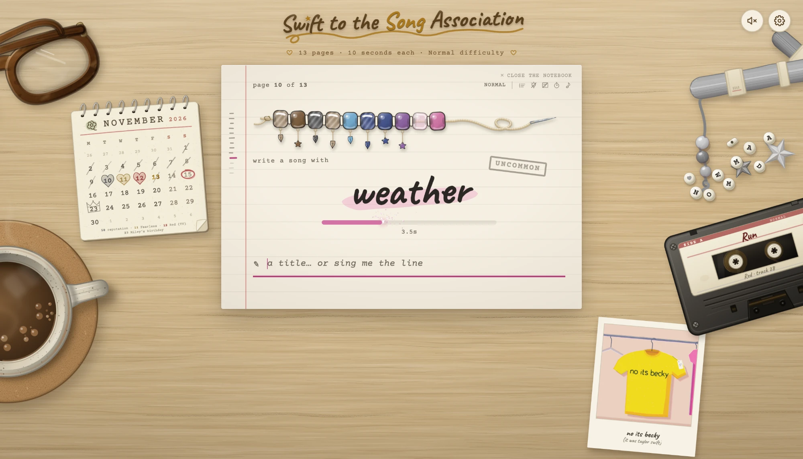

# Welcome to the ✨Swift to the Song Association✨ repository

**[Play it at swiftassociation.com](https://swiftassociation.com)**, on your phone or your laptop. It's still in alpha.

I’m working on a game inspired by ELLE’s Song Association: by default you get 10 seconds to name a song or lyric with a specific word in it. The twist? It’s all Taylor Swift songs 🫶

*pretty sure that's Taylor Swift*

## Standout features

**Ways to play**

- Infinite mode
- Album focus mode so you can concentrate on ONE album only
- Daily challenge
- The ability to make your own **custom modes**
- A guest shelf of other artists' catalogues, played on their own and never mixed into Taylor's
- The lineup: thirteen pages from every catalogue at once, played under goal cards you pick before page one
- A shelf of bonus mini-games, most with an endless side where one miss ends it
- Ruthless Game, where the song writes itself out a word a second and your time is the score

**The long game**

- Challenges mode with 32 challenges, most with a harder "dark side" to unlock, plus a super-hard tier unlocked through mastery
- A skills and mastery system full of rewards
- Over 200 achievements to unlock
- Polaroids to collect, that you can eventually display on the desk itself
- Stickers to earn, which get stuck on the notebook cover

**The details**

- Every era, plus holiday, movie and collaboration songs (and some unreleased songs too!)
- Unique UI with a notebook theme, and lots and lots of easter eggs
- Lyricist mode, where you answer by typing a lyric line instead of a song title
- A start button that snows all December and dresses up for album release days, her birthday, Christmas, both sides of New Year, the 13th of every month and the guest shelf's birthdays
- Snow that builds up on everything on the desk, a little more each day of December
- A stats page to track your stats across all your games
- Personal bests displayed in a fun way
- Beads that record how a page went, and finished bracelets you can copy or download as a PNG
- A companion lyric searcher, [Swift to the Lyric](https://swiftassociation.com/search), for searching every line of every song
- A night version of the whole desk, and a high-contrast setting that works in either light
- Installable as a phone or desktop app, with offline readiness in Settings

I want this game to have extensive replay value, to be challenging, and to work for as many people as possible, so accessibility is part of the work and all feedback is welcome at [swiftassociation.com/feedback](https://swiftassociation.com/feedback). Above all, **I want it to be fun.**

*no its becky*

## Licence

The source code in this repository is © Corey Shurdington, all rights reserved. You are very welcome to read it, poke around it, and learn from it. It is not licensed for reuse, redistribution, or deployment, commercially or otherwise. If you want to do something with it, just ask me.

This covers my code only. The lyrics and liner-note messages in `data/songs.json`, `data/guests/` and `data/secret-messages.json` belong to their respective writers and publishers. They are not mine, and nothing above grants any rights to them. The fonts and sound effects carry their own licences, which are set out in [NOTICE.md](NOTICE.md).

Verdict sounds from [Google’s Material Design sound kit](https://archive.org/details/material-design-sound-resources) (CC-BY 4.0); the page turn, the glockenspiel (heard whole on an unlock, and as a single note when a hint reveals), the clock tick, the pencil stroke and the book closing are CC0 recordings from freesound.
